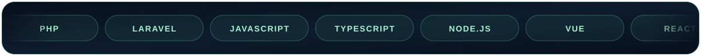

<!-- ╔══════════════════════════════════════════════════════════════════════════╗ -->
<!-- ║              IBRAHIM AHMED · FULL-STACK WEB DEVELOPER                    ║ -->
<!-- ║              "Ship it, then make it beautiful."                          ║ -->
<!-- ║   All visuals below are self-hosted animated SVGs — no external deps.    ║ -->
<!-- ╚══════════════════════════════════════════════════════════════════════════╝ -->

<div align="center">

<!-- ══════════════════════ HERO (auto dark / light) ══════════════════════ -->
<picture>
  <source media="(prefers-color-scheme: dark)"  srcset="https://raw.githubusercontent.com/ibraimfarag/ibraimfarag/main/assets/banner-dark.svg"/>
  <source media="(prefers-color-scheme: light)" srcset="https://raw.githubusercontent.com/ibraimfarag/ibraimfarag/main/assets/banner-light.svg"/>
  
</picture>

<br/>

<!-- ══════════════════════════ TYPING LINE ══════════════════════════ -->


<br/><br/>

<!-- ══════════════ LIVE GITHUB COUNTERS (dynamic · not clickable) ══════════════ -->


<br/><br/>

<!-- ══════════════════════════ TECH TICKER ══════════════════════════ -->


</div>

<br/>

<!-- ══════════════════════════ BRAND BANNER (110KB, was 4.9MB) ══════════════════════════ -->
<picture>
  <source type="image/webp" srcset="https://raw.githubusercontent.com/ibraimfarag/ibraimfarag/main/assets/brand.webp"/>
  
</picture>

<br/>


<!-- ═══════════════════════════════════════════════════════════════════════════ -->
<!--                                  ABOUT ME                                    -->
<!-- ═══════════════════════════════════════════════════════════════════════════ -->

<table>
<tr>
<td valign="top" width="34%" align="center">

### ✨ Ibrahim Ahmed

<sub>🇪🇬 Egypt &nbsp;·&nbsp; 🌍 Remote</sub>

<br/>


<sub><code>ibrahimahmed.online</code> &nbsp;·&nbsp; <code>ib.farag@gmail.com</code></sub>

<!-- 🔧 Add more badges as raw  tags (keeps them non-clickable), e.g.:


-->

</td>
<td valign="top" width="66%">

### 👋 Hey, I'm Ibrahim

**Full-Stack Web Developer** with **6+ years** of turning ideas into products people actually enjoy using. I own the whole journey — clean architecture, secure APIs, and interfaces that feel effortless.

```yaml
role:       Full-Stack Web Developer
experience: 6+ years
core:       PHP · Laravel · JavaScript · Node.js
also:       Flutter · Rust · Vue · React · Angular
interests:  DevTools · Cybersecurity · AI Agents · DX
values:     Performance · Security · Simplicity · UX
motto:      "Ship it, then make it beautiful."
```

**🔭 Currently** — building **MIF**, an open-source cybersecurity command center
**🌱 Learning** — Rust · Agentic AI systems
**⚡ Fun fact** — I debug faster with a strong cup of ☕

</td>
</tr>
</table>

<br/>


<!-- ═══════════════════════════════════════════════════════════════════════════ -->
<!--                              CORE PROFICIENCY                                -->
<!-- ═══════════════════════════════════════════════════════════════════════════ -->

<div align="center">



</div>

<br/>


<!-- ═══════════════════════════════════════════════════════════════════════════ -->
<!--                                 TECH STACK                                   -->
<!-- ═══════════════════════════════════════════════════════════════════════════ -->

<div align="center">

## 🛠️ &nbsp;Full Toolkit

<br/>


<br/><br/>


<br/><br/>


<br/><br/>


</div>

<br/>


<!-- ═══════════════════════════════════════════════════════════════════════════ -->
<!--                                 WHAT I DO                                    -->
<!-- ═══════════════════════════════════════════════════════════════════════════ -->

<div align="center">

## 💼 &nbsp;What I Do

<sub>Four ways I help teams and founders ship.</sub>

</div>

<table>
<tr>
<td valign="top" width="50%">

### 🌐 &nbsp;Web Applications
End-to-end products with **Laravel**, **Next.js**, and **Vue** — from database design to a polished, responsive UI.

</td>
<td valign="top" width="50%">

### 🔌 &nbsp;APIs & Backends
RESTful APIs, secure auth flows, background jobs, and third-party integrations built to scale.

</td>
</tr>
<tr>
<td valign="top" width="50%">

### 📱 &nbsp;Mobile & Desktop
Cross-platform apps with **Flutter** & **Dart**, plus desktop tooling with **Electron**.

</td>
<td valign="top" width="50%">

### ☁️ &nbsp;DevOps & Delivery
**Docker**, CI/CD with **Jenkins** & **GitHub Actions**, deployed on **AWS** / **Azure** / Linux.

</td>
</tr>
</table>

<br/>


<!-- ═══════════════════════════════════════════════════════════════════════════ -->
<!--                                  TERMINAL                                    -->
<!-- ═══════════════════════════════════════════════════════════════════════════ -->

<div align="center">

## ⌨️ &nbsp;In My Natural Habitat



</div>

<br/>


<!-- ═══════════════════════════════════════════════════════════════════════════ -->
<!--                              FEATURED PROJECTS                               -->
<!-- ═══════════════════════════════════════════════════════════════════════════ -->

<div align="center">

## 🚀 &nbsp;Featured Projects

<sub>A few things I've designed, built, and shipped.</sub>

<br/>


<br/>


<br/><br/>


</div>

<br/>


<!-- ═══════════════════════════════════════════════════════════════════════════ -->
<!--                                GITHUB ANALYTICS                              -->
<!-- ═══════════════════════════════════════════════════════════════════════════ -->

<div align="center">

## 📊 &nbsp;GitHub Analytics

<sub>Numbers that keep me honest.</sub>

<br/>


<br/>


<br/><br/>


<br/>


<br/>


</div>

<br/>


<!-- ═══════════════════════════════════════════════════════════════════════════ -->
<!--                              CONTRIBUTION SNAKE                              -->
<!-- ═══════════════════════════════════════════════════════════════════════════ -->

<div align="center">

## 🐍 &nbsp;Contributions, Eaten Daily

<picture>
  <source media="(prefers-color-scheme: dark)"  srcset="https://raw.githubusercontent.com/ibraimfarag/ibraimfarag/output/github-contribution-grid-snake-dark.svg"/>
  <source media="(prefers-color-scheme: light)" srcset="https://raw.githubusercontent.com/ibraimfarag/ibraimfarag/output/github-contribution-grid-snake.svg"/>
  
</picture>

</div>

<br/>


<!-- ═══════════════════════════════════════════════════════════════════════════ -->
<!--                                   FOOTER                                     -->
<!-- ═══════════════════════════════════════════════════════════════════════════ -->

<div align="center">


<br/><br/>


<br/><br/>


</div>
